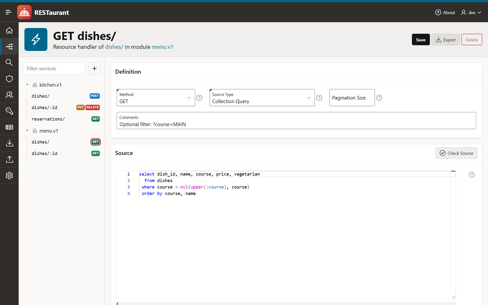

<p align="center">
  
</p>

<h1 align="center">RESTaurant</h1>

<p align="center">
  Der Editor für ORDS RESTful Services, zurück als Oracle-APEX-Anwendung.<br>
  Module, Templates und Handler, Sicherheit und ein sauberer Export und Import.
</p>

<p align="center"><a href="README.md">English version</a></p>



## Warum

Bis Oracle APEX 26.1 gab es im SQL Workshop die Seite *RESTful Services*, mit der sich Module, Templates und Handler
von Oracle REST Data Services (ORDS) bearbeiten ließen. In APEX 26.2 ist sie nicht mehr enthalten.

RESTaurant bringt den Editor als normale APEX-Anwendung zurück, die in den eigenen Workspace installiert wird. Sie
deckt ab, was die alte Seite konnte, und ergänzt, was gefehlt hat: eine Request-Konsole, eine Suche über den Quelltext
aller Handler, das Duplizieren von Modulen und einen Export und Import für ein ganzes Schema, ein Modul, ein einzelnes
Template oder einen einzelnen Handler.

## Funktionen

**Services bearbeiten**

- Module, Templates, Handler und Parameter, mit einem Baum zur Navigation
- Module und Templates umbenennen, ohne dass der Inhalt darunter verloren geht
- Module veröffentlichen und zurückziehen, erlaubte Origins, Seitengröße, schützendes Privileg
- Quelltext-Editor mit Syntax-Highlighting für SQL, PL/SQL und JavaScript und einer Liste der Bind-Variablen, die ORDS
  bereitstellt
- Compile-Prüfung beim Tippen: Die Datenbank parst den Quelltext, ohne ihn auszuführen; der erste Fehler wird mit
  Zeile und Spalte markiert. *Check Handlers* prüft ein Modul oder das ganze Schema, zum Beispiel nach einem Import.
- *Try it*: einen Request direkt aus der Seite an den gespeicherten Handler senden und Status, Header und Body lesen,
  oder den Request als cURL-Befehl kopieren
- Suche im Quelltext aller Handler
- Modul unter neuem Namen und Basispfad duplizieren

**Sicherheit**

- Privilegien mit Rollen, geschützten Modulen und URL-Mustern
- Rollen
- OAuth-Clients: registrieren, Rollen und Privilegien zuweisen, neues Secret erzeugen. Das Secret wird genau einmal
  angezeigt.

**Außerdem**

- AutoREST: Tabellen, Views und PL/SQL-Objekte freigeben, Alias und Zugriff ändern
- Schema-Einstellungen: Schema für ORDS aktivieren, Schema-Alias ändern, Links zum OpenAPI-Katalog
- Dashboard mit Kennzahlen und den zuletzt geänderten Handlern

**Export und Import**

- Umfang: das ganze Schema, ausgewählte Module, ein Modul, ein Template oder ein Handler
- Formate: JSON (das unten beschriebene Austauschformat), ein SQL-Skript mit Aufrufen der ORDS-API oder ein
  ZIP-Archiv mit einer JSON-Datei pro Modul
- Der Import zeigt vor dem Schreiben Element für Element, was die Datei im Vergleich zum Schema enthält
- Vorhandene Module zusammenführen, ersetzen oder überspringen, Module auswählen, unter anderem Namen oder Basispfad
  importieren, als nicht veröffentlicht importieren
- Ein Import schreibt nur, was sich unterscheidet; unveränderte Handler behalten ihr Änderungsdatum

Screenshots stehen in der [englischen README](README.md#what-it-does).

## Voraussetzungen

- Oracle APEX 26.2 oder neuer
- Oracle REST Data Services mit dem Package `ORDS_SECURITY`, das die Seiten für OAuth-Clients verwenden
- Ein Workspace und ein ihm zugeordnetes Schema

Entwickelt und getestet mit APEX 26.2 und ORDS 26.3 auf Oracle AI Database 26ai Free.

Die Anwendung legt **keine Tabellen, Packages oder sonstigen Objekte** an. Sie liest die Views `USER_ORDS_*` und ruft
die dokumentierten PL/SQL-APIs `ORDS` und `ORDS_SECURITY` mit den Rechten ihres Parsing-Schemas auf.

## Installation

Der Installer ist eine einzige Datei: [`dist/restaurant.sql`](dist/restaurant.sql).

**App Builder.** *App Builder → Import*, `dist/restaurant.sql` auswählen, als Parsing-Schema das Schema wählen, dessen
Services bearbeitet werden sollen, installieren.

**SQLcl oder SQL\*Plus.** Im Wurzelverzeichnis des Repositorys, angemeldet als Parsing-Schema oder als Benutzer mit
`APEX_ADMINISTRATOR_ROLE`:

```
sql hr/passwort@datenbank @install.sql MEIN_WORKSPACE HR
```

Als drittes Argument kann eine Anwendungs-ID angegeben werden, sonst wird eine freie erzeugt.

Die Anwendung arbeitet immer auf ihrem **Parsing-Schema**. Für mehrere Schemas wird sie einmal pro Schema installiert;
`install.sql` gibt der zweiten Kopie in einem Workspace einen eigenen Alias.

Die Anmeldung erfolgt mit dem APEX-Workspace-Benutzer. Ist das Schema noch nicht für ORDS aktiviert, weist das
Dashboard darauf hin; aktiviert wird es unter *Schema Settings*.

### Wer darf die Anwendung benutzen

Die gesamte Anwendung ist durch ein einziges Autorisierungsschema geschützt: **`IST_ADMIN`**. Im Auslieferungszustand
ist es eine *Exists SQL Query*, die immer eine Zeile liefert:

```sql
select 1 from dual
```

Damit ist jeder angemeldete Benutzer Administrator. Um den Zugriff einzuschränken, wird die Abfrage unter *Shared
Components → Authorization Schemes* angepasst, zum Beispiel:

```sql
select 1 from meine_admins where username = :APP_USER
```

Das Authentifizierungsschema ist *Oracle APEX Accounts* und lässt sich wie in jeder anderen Anwendung austauschen.

## Export und Import

### Das Austauschformat

Ein JSON-Export ist für die Versionsverwaltung gemacht:

- **Stabil.** Feste Reihenfolge der Schlüssel, Listen sind nach ihrem natürlichen Schlüssel sortiert, das Layout hängt
  nicht von der Datenbankversion ab. Dieselben Services ergeben immer dieselbe Datei, Byte für Byte.
- **Lesbare Diffs.** Quelltext ist ein Array mit einem Eintrag pro Zeile.
- **Unabhängig vom Schema.** Keine IDs, kein Schemaname. Eine Datei lässt sich überall importieren.
- **Teil-Exporte.** Der Export eines Templates oder Handlers enthält sein Modul als Kontext und ist mit
  `"partial": true` markiert. Ein Import ergänzt das Modul und entfernt nie etwas.

Die vollständige Beschreibung steht in [docs/exchange-format.md](docs/exchange-format.md), das JSON-Schema in
[docs/schema/restaurant-ords-v1.schema.json](docs/schema/restaurant-ords-v1.schema.json), Beispieldateien in
[examples](examples).

### Dateinamen

| Umfang | Datei |
|---|---|
| Schema, mehrere Module | `<schema>-rest-services.ords.json` |
| Modul | `<modul>.ords.json` |
| Template | `<modul>--<template>.ords.json` |
| Handler | `<modul>--<template>--<methode>.ords.json` |

SQL-Skripte enden auf `.ords.sql`, Archive auf `.ords.zip`. Ein Archiv enthält `modules/<modul>.ords.json` für jedes
Modul und `security.ords.json` für Rollen und Privilegien.

### Importieren

1. *Import*: eine `.json`- oder `.zip`-Datei ablegen oder das JSON einfügen.
2. *Review*: Jedes Element ist als neu, geändert oder unverändert markiert. Was nur im Schema existiert, wird ebenfalls
   aufgeführt.
3. Festlegen, was mit bereits vorhandenen Modulen geschieht:

| Modus | Wirkung auf ein vorhandenes Modul |
|---|---|
| Merge | Templates und Handler der Datei werden ergänzt oder aktualisiert, alles andere bleibt |
| Replace | Das Modul entspricht danach genau der Datei; Templates und Handler, die nur im Schema existieren, werden entfernt |
| Skip | Das Modul bleibt unangetastet |

Rollen und Privilegien sind optional. Beim Import eines Privilegs bleiben die Modulzuordnungen erhalten, die es im
Zielschema bereits hat; Module, die dort nicht existieren, werden ignoriert. OAuth-Clients sind nicht Teil eines
Exports, weil sich ihre Secrets nicht auslesen lassen.

Das SQL-Skript ist die Alternative, wenn es im Ziel kein RESTaurant gibt: als Eigentümer-Schema mit SQLcl oder
SQL\*Plus ausführen.

## Wie es ohne Datenbankobjekte funktioniert

Die Logik, die mehr als eine Seite braucht (ein Modul in das Austauschformat lesen, zurückschreiben, vergleichen, SQL
erzeugen), steht in einem einzigen PL/SQL-Block:
[`src/shared-components/static-files/engine/restaurant-engine.sql`](src/shared-components/static-files/engine/restaurant-engine.sql).
Er wird als statische Anwendungsdatei ausgeliefert. Ein kleines Prozess-Plug-in lädt die Datei und führt sie mit der
Aktion des Seitenprozesses aus, etwa `MODULE_SAVE` oder `IMPORT_APPLY`. Der Service-Baum ist ein Regions-Plug-in. Im
Schema wird nichts kompiliert.

ORDS ersetzt die Kinder eines Elements, wenn das Element neu definiert wird. Die Engine liest ein Element deshalb mit
allem, was darunter liegt, ändert es und schreibt es in einer Transaktion zurück. So lässt sich ein Modul umbenennen
oder ein einzelner Parameter entfernen, obwohl die API dafür keinen Aufruf hat.

## Der Editor und die Compile-Prüfung

Beides nutzt nur, was ohnehin vorhanden ist.

**Syntax-Highlighting** liefert der Monaco-Editor, der mit APEX ausgeliefert wird, also der Editor des App Builders.
Die Anwendung lädt ihn aus den APEX-Dateien der eigenen Instanz; es wird nichts von außen nachgeladen und die Anwendung
enthält keine Kopie davon. APEX hat dafür keinen Item-Typ, deshalb ermittelt die Anwendung die Version über
`apex.libVersions` und startet den Editor selbst. Sollte das einmal nicht mehr funktionieren, etwa nach einem Upgrade,
das die Dateien verschiebt, fällt das Quelltext-Feld auf ein einfaches Textfeld mit Zeilennummern zurück. Alles andere
funktioniert weiter.

**Die Compile-Prüfung** übernimmt die Datenbank. Der Quelltext wird an `DBMS_SQL.PARSE` übergeben; das findet
Syntaxfehler sowie unbekannte Tabellen, Spalten und Programmeinheiten. Ausgeführt wird er dabei nie: Eine Abfrage wird
als Inline-View geparst und PL/SQL als verschachtelter Block, sodass eine Anweisung anderer Art, etwa DDL, ein
Syntaxfehler ist.

- Geprüft wird beim Öffnen eines Handlers, kurz nach dem letzten Tastendruck und über *Check Source*, und zwar das,
  was im Editor steht, gespeichert oder nicht. Ein Handler, der nicht kompiliert, lässt sich trotzdem speichern.
- Die Datenbank meldet den ersten Fehler. Ein Klick auf die Meldung springt zur Stelle.
- Bei PL/SQL mit Bind-Variablen prüft die Datenbank nur die Syntax. Für die vollständige Prüfung ersetzt die Anwendung
  jede Bind-Variable durch eine lokale Variable. Deren Typ ergibt sich aus den Parametern des Handlers; `:body` ist ein
  BLOB, `:body_text` ein CLOB, alles andere eine Zeichenkette. Ein Cursor, der für eine Bind-Variable geöffnet wird,
  braucht deshalb zuerst seinen Parameter vom Typ RESULTSET.
- JavaScript-Handler werden hervorgehoben, aber nicht geprüft.

## Entwicklung

Die Anwendung wird als APEXlang-Quelltext in [`src`](src) entwickelt. Der Installer in `dist` wird daraus exportiert.

```
docker compose -f dev/docker/compose.yaml up -d --build     # Datenbank, APEX und ORDS auf localhost:8282
scripts/dev.sh sql dev/setup/sample-services.sql            # Beispieltabellen und -services
scripts/dev.sh import                                       # src validieren und importieren
scripts/dev.sh export                                       # dist/restaurant.sql schreiben
```

Der erste Start installiert APEX in die Datenbank und dauert eine Weile. `dev/setup/workspace.sql`, als SYS ausgeführt,
legt den Workspace `RESTAURANT` mit gleichnamigem Schema und den Entwickler `DEV` an; die Passwörter stehen im Skript
und sind nur für eine lokale Sandbox gedacht.

## Gut zu wissen

- Handler unterstützen die Methoden GET, POST, PUT und DELETE.
- Wird bei einem Modul die Seitengröße oder der Kommentar geändert, definiert das Speichern das Modul neu. Templates
  und Handler werden unverändert zurückgeschrieben, tragen danach aber den Zeitpunkt des Speicherns als Änderungsdatum.
- Die Request-Konsole sendet den Request aus dem Browser, ohne die Session-Cookies der Anwendung. Für einen
  geschützten Service wird ein `Authorization`-Header ergänzt.
- ORDS vermerkt in seinen Audit-Spalten den Datenbankbenutzer. Änderungen über APEX zeigen dort den öffentlichen
  APEX-Benutzer.

## Lizenz

[MIT](LICENSE)
