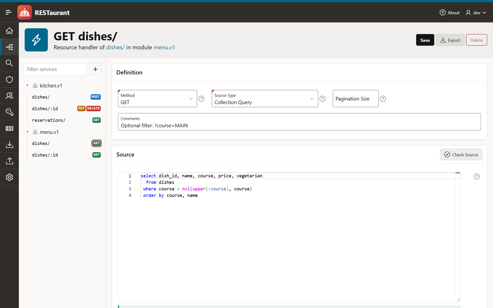
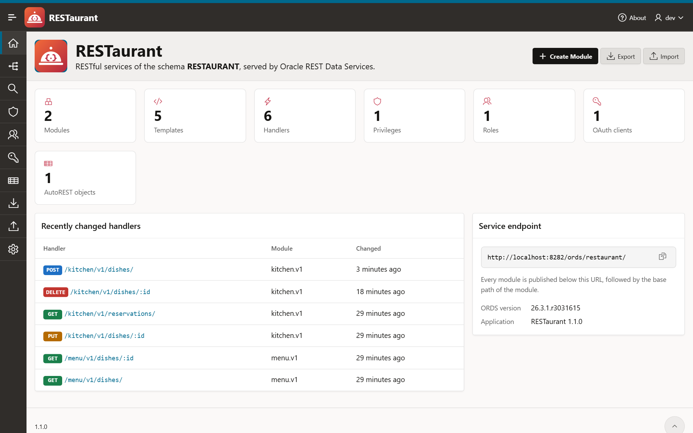
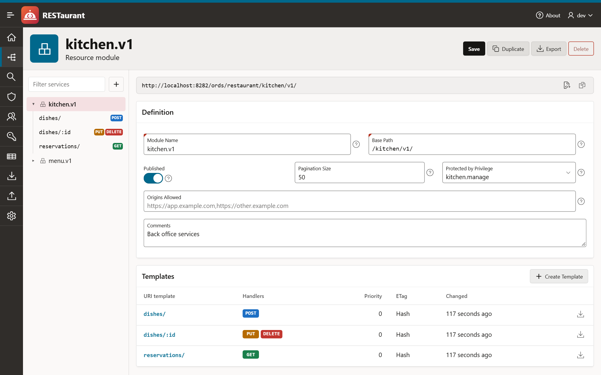
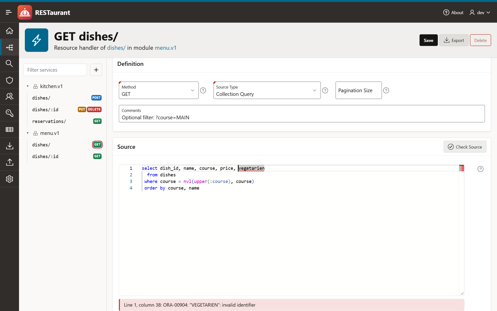
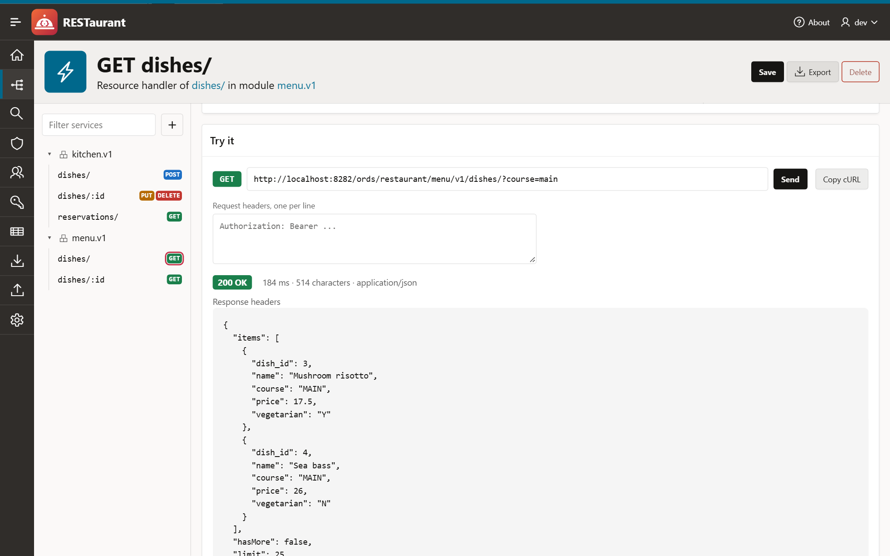
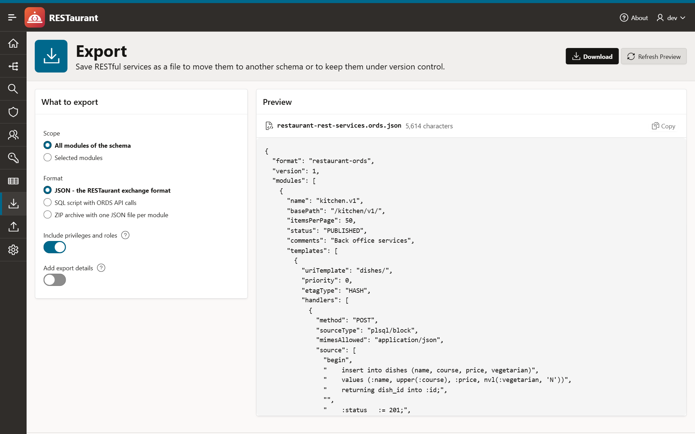
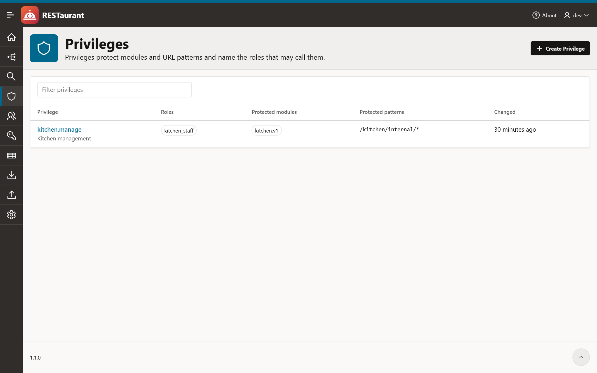
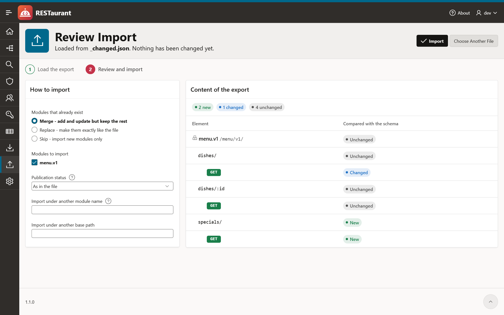
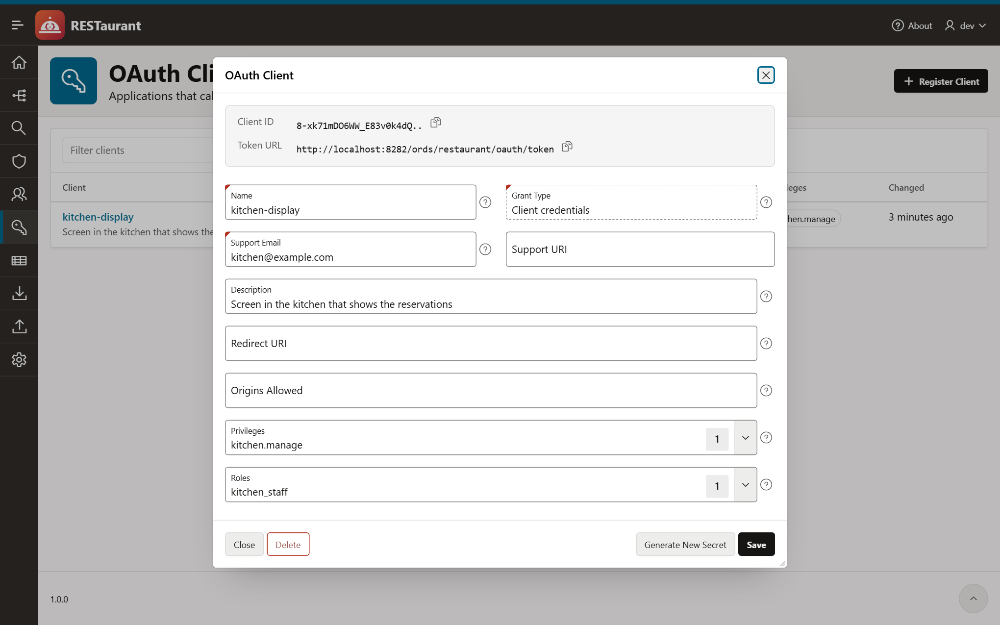

<p align="center">
  
</p>

<h1 align="center">RESTaurant</h1>

<p align="center">
  The editor for ORDS RESTful services, back as an Oracle APEX application.<br>
  Modules, templates and handlers, security, and a clean export and import.
</p>

<p align="center">
  
  
  
</p>

<p align="center"><a href="README.de.md">Deutsche Fassung</a></p>



## Why

Up to Oracle APEX 26.1 the SQL Workshop had a page called *RESTful Services* for editing the modules, templates and
handlers of Oracle REST Data Services (ORDS). APEX 26.2 no longer ships it.

RESTaurant brings the editor back as a normal APEX application that you install into your own workspace. It covers
what the old page did and adds the things that were missing: a request console, a search across all handler sources,
duplicating modules, and an export and import that works for a whole schema, a module, a single template or a single
handler.

## What it does

**Edit services**

- Modules, templates, handlers and parameters, with a tree to move between them
- Rename a module or a template and keep everything below it
- Publish and unpublish modules, allowed origins, pagination size, protecting privilege
- Source editor with syntax highlighting for SQL, PL/SQL and JavaScript and a list of the bind variables ORDS provides
- Compile check while you type: the database parses the source without running it and the first error is marked
  with its line and column. *Check Handlers* does the same for a module or the whole schema, for example after an
  import.
- *Try it*: send a request to the saved handler from the page and read status, headers and body, or copy it as cURL
- Search the source of all handlers
- Duplicate a module under a new name and base path

**Security**

- Privileges with roles, protected modules and URL patterns
- Roles
- OAuth clients: register, grant roles and privileges, generate a new secret. The secret is shown once.

**More**

- AutoREST: enable tables, views and PL/SQL objects, change alias and access
- Schema settings: enable the schema for ORDS, change the schema alias, links to the OpenAPI catalog
- Dashboard with counts and the handlers changed last

**Export and import**

- Scope: the whole schema, selected modules, one module, one template or one handler
- Formats: JSON (the exchange format described below), a SQL script with ORDS API calls, or a ZIP archive with one
  JSON file per module
- The import shows what a file contains compared with the schema, element by element, before anything is written
- Merge, replace or skip existing modules, pick the modules to import, import under another name or base path,
  import as not published
- An import only writes what differs, so unchanged handlers keep their change date

| | |
|---|---|
|  |  |
|  |  |
|  |  |
|  |  |

## Requirements

- Oracle APEX 26.2 or later
- Oracle REST Data Services with the `ORDS_SECURITY` package, which the OAuth client pages use
- A workspace and a schema that is assigned to it

Developed and tested with APEX 26.2 and ORDS 26.3 on Oracle AI Database 26ai Free.

The application creates **no tables, packages or other objects**. It reads the `USER_ORDS_*` views and calls the
documented `ORDS` and `ORDS_SECURITY` PL/SQL APIs with the rights of its parsing schema.

## Installation

The installer is one file: [`dist/restaurant.sql`](dist/restaurant.sql).

**App Builder.** *App Builder → Import*, choose `dist/restaurant.sql`, pick the parsing schema whose services you want
to edit, install.

**SQLcl or SQL\*Plus.** From the root of the repository, connected as the parsing schema or as a user with
`APEX_ADMINISTRATOR_ROLE`:

```
sql hr/password@database @install.sql MY_WORKSPACE HR
```

An application id can be given as a third argument, otherwise a free one is generated.

The application always works on its **parsing schema**. To manage several schemas, install it once per schema;
`install.sql` gives the second copy in a workspace its own alias.

Sign in with your APEX workspace account. If the schema is not enabled for ORDS yet, the dashboard says so and
*Schema Settings* enables it.

### Who may use it

The whole application is guarded by one authorization scheme, **`IST_ADMIN`**. As delivered it is an *Exists SQL
Query* that always returns a row:

```sql
select 1 from dual
```

so every user who can sign in is an administrator. To restrict access, change the query under *Shared Components →
Authorization Schemes*, for example:

```sql
select 1 from my_admins where username = :APP_USER
```

The authentication scheme is *Oracle APEX Accounts* and can be replaced like in any other application.

## Export and import

### The exchange format

A JSON export looks like this:

```json
{
  "format": "restaurant-ords",
  "version": 1,
  "modules": [
    {
      "name": "menu.v1",
      "basePath": "/menu/v1/",
      "itemsPerPage": 25,
      "status": "PUBLISHED",
      "comments": "Public menu of the restaurant",
      "templates": [
        {
          "uriTemplate": "dishes/:id",
          "priority": 0,
          "etagType": "HASH",
          "handlers": [
            {
              "method": "GET",
              "sourceType": "json/item",
              "source": [
                "select dish_id, name, course, price, vegetarian, created_on",
                "  from dishes",
                " where dish_id = :id"
              ],
              "parameters": []
            }
          ]
        }
      ]
    }
  ]
}
```

It is made for version control:

- **Stable.** Keys have a fixed order, lists are sorted by their natural key, the layout does not depend on the
  database version. Exporting the same services twice gives the same file, byte for byte.
- **Readable diffs.** Source code is an array with one entry per line.
- **Independent of the schema.** No ids, no schema name. A file can be imported anywhere.
- **Partial exports.** The export of a template or a handler carries its module as context and is marked
  `"partial": true`. Importing it adds to the module and never removes anything.

The full description is in [docs/exchange-format.md](docs/exchange-format.md), the JSON schema in
[docs/schema/restaurant-ords-v1.schema.json](docs/schema/restaurant-ords-v1.schema.json), sample files in
[examples](examples).

### File names

| Scope | File |
|---|---|
| Schema, several modules | `<schema>-rest-services.ords.json` |
| Module | `<module>.ords.json` |
| Template | `<module>--<template>.ords.json` |
| Handler | `<module>--<template>--<method>.ords.json` |

SQL scripts end in `.ords.sql`, archives in `.ords.zip`. An archive contains `modules/<module>.ords.json` for each
module and `security.ords.json` for roles and privileges.

### Importing

1. *Import*: drop a `.json` or `.zip` file, or paste the JSON.
2. *Review*: every element is marked as new, changed or unchanged. What exists only in the schema is listed too.
3. Choose how to treat modules that already exist:

| Mode | Effect on an existing module |
|---|---|
| Merge | Templates and handlers of the file are added or updated, everything else stays |
| Replace | The module becomes exactly like the file; templates and handlers that are only in the schema are removed |
| Skip | The module is left alone |

Roles and privileges are optional. Importing a privilege keeps the module links it already has in the target schema
and ignores modules that do not exist there. OAuth clients are not part of an export, because their secrets cannot
be read.

The SQL script is the alternative when the target has no RESTaurant: run it as the owning schema with SQLcl or
SQL\*Plus.

## How it works without database objects

All logic that more than one page needs, such as reading a module into the exchange format, writing it back,
comparing, generating SQL, lives in one PL/SQL block:
[`src/shared-components/static-files/engine/restaurant-engine.sql`](src/shared-components/static-files/engine/restaurant-engine.sql).
It is shipped as a static application file. A small process plug-in loads the file and runs it with the action of the
page process, for example `MODULE_SAVE` or `IMPORT_APPLY`. The service tree is a region plug-in. Nothing is compiled
into the schema.

ORDS replaces the children of an element when the element is defined again. The engine therefore reads the element
with everything below it, changes it and writes it back, in one transaction. That is how a module can be renamed or
a single parameter removed although the API has no call for it.

## The editor and the compile check

Both use only what is already there.

**Syntax highlighting** comes from the Monaco editor that ships with APEX, the editor of the App Builder. The
application loads it from the APEX files of your instance; nothing is downloaded from elsewhere and the application
contains no copy of it. APEX has no item type for it, so the application looks up the version through
`apex.libVersions` and starts the editor itself. Should that ever stop working, for example after an upgrade that
moves the files, the source field falls back to a plain text area with line numbers. Everything else keeps working.

**The compile check** is done by the database. The source is passed to `DBMS_SQL.PARSE`, which finds syntax errors and
unknown tables, columns and program units, and it is never executed: a query is parsed as an inline view and PL/SQL as
a nested block, so a statement of another kind, such as DDL, is a syntax error.

- The check runs when a handler is opened, shortly after you stop typing, and on *Check Source*. It works on what is
  in the editor, saved or not. A handler that does not compile can still be saved.
- The database reports the first error. Click the message to jump to it.
- The database only checks the syntax of PL/SQL that contains bind variables. For the full check the application
  replaces every bind variable by a local variable. Its type comes from the parameters of the handler; `:body` is a
  BLOB, `:body_text` a CLOB, everything else a string. A cursor opened for a bind variable therefore needs its
  parameter of the type RESULTSET first.
- JavaScript handlers are highlighted but not checked.

## Development

The application is developed as APEXlang source in [`src`](src). The installer in `dist` is exported from it.

```
docker compose -f dev/docker/compose.yaml up -d --build     # database, APEX and ORDS on localhost:8282
scripts/dev.sh sql dev/setup/sample-services.sql            # sample tables and services
scripts/dev.sh import                                       # validate src and import it
scripts/dev.sh export                                       # write dist/restaurant.sql
```

The first start installs APEX into the database and takes a while. `dev/setup/workspace.sql`, run as SYS, creates the
workspace `RESTAURANT` with the schema of the same name and the developer `DEV`; the passwords are in the script and
are meant for a local sandbox only.

### Tests

`tests/e2e` plays the application through in a browser, the way a user would: it starts with a schema that has no REST
definitions, builds a service, calls it over HTTP, protects it, exports and imports it into a second schema, breaks
and repairs it, and removes everything again. It also covers the error cases of every form, a schema with more than
300 handlers and a copy of the application whose `IST_ADMIN` returns no row.

```
scripts/dev.sh test          # reset the test schemas, install dist/restaurant.sql, run all checks
```

The run needs Node.js and the sandbox, and installs Playwright on first use.

```
src/                    APEXlang source of the application
  pages/                one file per page
  shared-components/    plug-ins, static files (engine, CSS, JavaScript), lists, authorization
dist/restaurant.sql     single file installer
install.sql             command line installer
docs/                   exchange format, JSON schema, screenshots
examples/               sample exports
tests/e2e/              end-to-end walkthrough
dev/                    local sandbox and sample services
```

## Good to know

- Handlers support the methods GET, POST, PUT and DELETE.
- Saving a module after changing its pagination size or its comments defines the module again. Its templates and
  handlers are written back unchanged, but their change date is the time of the save.
- ORDS needs a moment to notice some changes. After such a save a service can answer with 404 for about a second,
  and an AutoREST object stays reachable under its old alias for a few seconds.
- The request console sends the request from your browser, without the session cookies of the application. For a
  protected service, add an `Authorization` header.
- ORDS records the database user in its audit columns. Changes made through APEX show the APEX public user there.

## License

[MIT](LICENSE)
